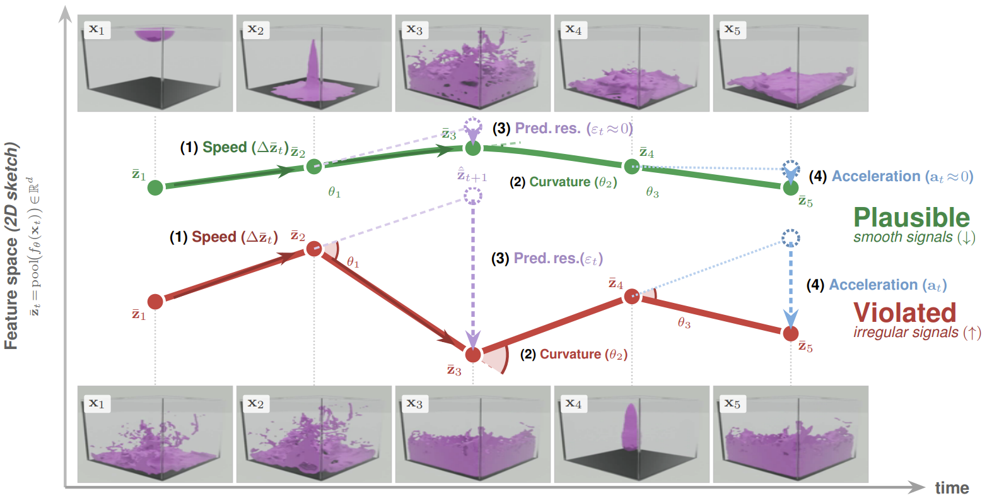

<div align="center">

# GeoPhys: The Geometry of Physical Plausibility

**Physical plausibility is written into the trajectory geometry of frozen image-encoder features.**

[](https://christianinterno.github.io/GeoPhys/)
[](https://arxiv.org/abs/2606.20707)
[](https://colab.research.google.com/github/ChristianInterno/GeoPhys/blob/main/notebooks/demo.ipynb)
[](LICENSE)
[](https://creativecommons.org/licenses/by/4.0/)



</div>

## Overview

A frozen image encoder maps each video frame to a feature; stacked across time, the video becomes a trajectory in representation space. Plausible motion keeps that trajectory smooth and locally predictable, while a physical violation disrupts it. GeoPhys reads this off with training-free geometric statistics of the trajectory (speed variation, curvature, angle consistency, acceleration, linear-prediction residual and a few more), computed directly on the features with no learned parameters.

The same score is applied unchanged across three settings: alignment with human EEG responses to object-permanence violations, physics-violation detection, and inference-time best-of-N verification for video generation. This repository contains the code for detection and verification, and a per-video plausibility score for rating generated videos.

## Highlights

- **Physics-violation detection.** 92.2% on LikePhys and 90.1% on IntPhys2 (GeoPhys+, macro accuracy), where V-JEPA 2, GPT-4o, Gemini, and twelve modern video diffusion models sit near chance.
- **A cheap verifier.** As a best-of-16 verifier, GeoPhys++ lifts MAGI-1 24B from 53.3 to 64.5 on Physics-IQ and 59.9 on Physics-IQ Verified.
- **Four frozen backbones.** DINOv2, DINOv3, CORnet-S, and VOneNet, none trained on video or physics.
- **Ready for your videos.** Three Python functions and command-line tools: which of two videos violates physics, the most plausible of several candidates, and one plausibility score per video.

See the [project page](https://christianinterno.github.io/GeoPhys/) and the [paper](https://arxiv.org/abs/2606.20707) for details.

## Quick start

```python
import geophys

geophys.rate(["a.mp4", "b.mp4", "c.mp4"])      # one score per video: 0.5 typical, higher = less plausible
geophys.compare("a.mp4", "b.mp4")              # which of the two violates physics
geophys.pick(["c0.mp4", "c1.mp4", "c2.mp4"])   # index of the most plausible candidate
```

New to GeoPhys? [`notebooks/demo.ipynb`](notebooks/demo.ipynb)
([open in Colab](https://colab.research.google.com/github/ChristianInterno/GeoPhys/blob/main/notebooks/demo.ipynb))
builds a few toy videos and shows the trajectory geometry and the scores in five minutes.

| `python -m ...` | What it does |
|---|---|
| `geophys.detect` | detection (LikePhys, IntPhys2) |
| `geophys.verify` | best-of-N (Physics-IQ) |
| `geophys.pairs` | which video of each pair violates physics, on a folder of your pairs (`compare`) |
| `geophys.select` | the most plausible candidate, on a folder of your candidates (`pick`) |
| `geophys.score` | one plausibility score per video, on folders of videos (`rate`) |
| `geophys.calibrate` | a configuration for your own labelled pairs, for specific domain app. |

## Installation

```bash
git clone https://github.com/ChristianInterno/GeoPhys.git
cd GeoPhys
pip install -e .
pip install git+https://github.com/dicarlolab/CORnet git+https://github.com/dicarlolab/vonenet
```

Python 3.10, PyTorch 2.1 or newer, and a GPU for feature extraction. DINOv2 and DINOv3
are downloaded by `transformers` on first use (DINOv3 may ask you to accept its licence on
Hugging Face first). `geophys.rate` needs only DINOv3; `compare`, `pick` and the paper's
configurations use all four encoders, hence CORnet-S and VOneNet.

## Reproduce the paper

```bash
./setup.sh members        # member arrays and score tables (downloads the release folder, ~1.2 GB)
python -m geophys.detect --members members/
python -m geophys.verify --members members/
```

**Physical-violation detection** (accuracy over pairs, %, macro over scenario groups / micro over pairs)

| | LikePhys (800 pairs) | IntPhys2 (506 pairs) |
|---|---|---|
| GeoPhys| 92.22 | 90.07 |

**Best-of-16 verification** on Physics-IQ (MAGI-1 24B, video-to-video, 198 scenarios)

| | Score table | Official, original | Official, Verified |
|---|---|---|---|
| First candidate | 53.25 | | |
| GeoPhys | 65.51 | 64.58 | 59.90 |
| Best candidate | 73.14 | | |

## Use GeoPhys on your own videos

Each of the three Python functions above has a command-line twin that works on a folder.
Features are extracted once per encoder and preprocessing and cached under
`GEOPHYS_STORES` (default `~/geophys_stores`), so later runs on the same videos are fast;
from Python, pass many pairs or candidate sets in one call rather than looping.

**Which of two videos violates physics**

```
my_pairs/
  case_a/
    first.mp4
    second.mp4
  case_b/
    ...
```

```bash
python -m geophys.pairs --videos my_pairs/ --out verdicts.csv
```

Each case holds exactly two videos. The output names the one judged implausible, with a
confidence. If you know the answer, name the files so the plausible one sorts first and
add `--labelled` to get the accuracy.

**Pick the most plausible of several candidates**

```
my_videos/
  scenario_a/
    candidate_000.mp4
    candidate_001.mp4
    ...
```

```bash
python -m geophys.select --videos my_videos/ --out picks.csv --export picked/
```

Scores are compared within a scenario: GeoPhys ranks candidates against each other.

**One score per video** (for example to compare generative models)

```bash
python -m geophys.score --videos outputs/model_a outputs/model_b --out scores.csv
python -m geophys.score --videos outputs/model_a --reference real_videos/ --out scores.csv
```

Each video is encoded with DINOv3 (block 18), and five signals of its trajectory
(curvature, angle consistency, speed variation, acceleration, prediction residual) are
turned into percentiles among the videos scored together, or among `--reference`
videos. The score is their mean: 0.5 is typical, higher is less plausible. The command
prints the mean score of each folder with its standard error and writes every video's
score and signals to the CSV.

**Calibrate GeoPhys on your own labelled pairs**

```
my_labelled_pairs/
  case_a/
    a_plausible.mp4      # the plausible video sorts first
    b_implausible.mp4
```

```bash
python -m geophys.calibrate --pairs my_labelled_pairs/ --out configs/mine.json
python -m geophys.pairs --videos new_pairs/ --config configs/mine.json
```

`--metric curvature` (default) picks, for each encoder, the layer where the implausible
video of a pair is most curved relative to the plausible one, then keeps the `--size`
measurements (default 16) with the largest standardised difference between the two
videos. `--metric accuracy` uses the usual readout layers and adds measurements one at a
time, each time the one that most improves the accuracy on your pairs. The command
reports the accuracy on your pairs and a held-out accuracy (calibrated on half of the
pairs, tested on the other half, five times).

## Regenerate the features

The member arrays in `members/` can be recomputed from the videos.

1. Get the benchmarks: [LikePhys](https://github.com/yuanjianhao508/likephys) and
   [IntPhys2](https://github.com/facebookresearch/IntPhys2) (Main set) from their
   authors, and the Physics-IQ candidates with `./setup.sh videos`.
2. See which encoders, preprocessings and layers a configuration needs:

   ```bash
   python -m geophys.extract --config configs/geophys_detection.json --plan
   ```

3. Extract them, one line per store, for example:

   ```bash
   python -m geophys.extract --task detection --dataset likephys --backbone dinov3 --prep direct \
       --layers 18 --pairs data/likephys_pairs.json --data-root /path/to/LikePhys
   python -m geophys.extract --task physicsiq --backbone dinov3 --prep direct --layers 18
   ```

4. Run `geophys.detect` and `geophys.verify` with `--stores ~/geophys_stores` (or wherever
   `GEOPHYS_STORES` points) instead of `--members`.

## How it works

A video is decoded to at most 60 frames. Each frame goes once through a frozen encoder:
DINOv2 (block 12), DINOv3 (block 18), CORnet-S (IT) or VOneNet (V1 block). The features
of a video form a trajectory, either one per video (mean token, CLS token or all tokens
flattened) or one per spatial token. Every geometric signal is computed from the Gram
matrix of the trajectory (`geophys/signals.py`).

A **member** is one measurement, written as one entry of a configuration file:

```json
{"backbone": "cornet", "layer": "IT", "prep": "hf", "signal": "curv", "agg": "tok",
 "tvar": "spd", "post": "top25", "norm": "-"}
```

This reads: CORnet-S at IT, frames resized and centre-cropped (`hf`), one trajectory per
spatial token with speed-normalised steps, curvature per token, summarised by the mean of
the 25 largest.

A **configuration** is a list of members and a rule to combine them:

- *Pairs* (`*_detection.json`): each member compares the two videos of a pair
- *Best of N* (`*_physicsiq.json`): within each scenario, each member's values are
  normalised over the candidates (rank or z-score)

## Repository

```
geophys/
  backbones.py    frozen encoders and frame preprocessing
  extract.py      videos -> feature stores
  signals.py      geometric signals from trajectory Gram matrices
  members.py      configuration entries -> values per video
  ensemble.py     the vote (pairs) and the fusion (best of N)
  detect.py       paper tables, detection
  verify.py       paper tables, Physics-IQ
  pairs.py        your own pairs
  select.py       your own candidates
  score.py        one score per video
  calibrate.py    a configuration for your own pairs
  api.py          rate, compare, pick
configs/          the configurations of the paper
notebooks/        demo.ipynb
data/             benchmark pair lists and the Physics-IQ score table
setup.sh          downloads the released artefacts
```

Released artefacts (one [Drive folder](https://drive.google.com/drive/folders/1l8gnrSPCD2wxke8SbDU_rnze8wy5kM8B), fetched by `setup.sh`):
`members.tar.gz` (member arrays), `data.tar.gz` (score tables), `selections.tar` (the
candidates each Physics-IQ configuration picks) and `v2v_candidates.tar` (the 16
candidates of every scenario).

**VOneNet note.** The official VOneNet checkpoint does not load from its published URL.
The loader then builds VOneNet with a ResNet-50 back end and ImageNet weights, which is
what produced every VOneNet number here; it prints which path it took.

## Citation

```bibtex
@misc{interno2026geophys,
  title         = {GeoPhys: The Geometry of Physical Plausibility},
  author        = {Intern\`{o}, Christian and Pondaven, Alexander and Issa, Habon
                   and Pizzati, Fabio and Pinto, Francesco and Olhofer, Markus
                   and Laptev, Ivan and Torr, Philip and Simoncelli, Eero P.
                   and Hammer, Barbara and Klindt, David},
  year          = {2026},
  eprint        = {2606.20707},
  archivePrefix = {arXiv},
  primaryClass  = {cs.CV},
  url           = {https://arxiv.org/abs/2606.20707}
}
```

## License

The code is released under the [MIT License](LICENSE). The paper text and figures are released under [CC BY 4.0](https://creativecommons.org/licenses/by/4.0/).
